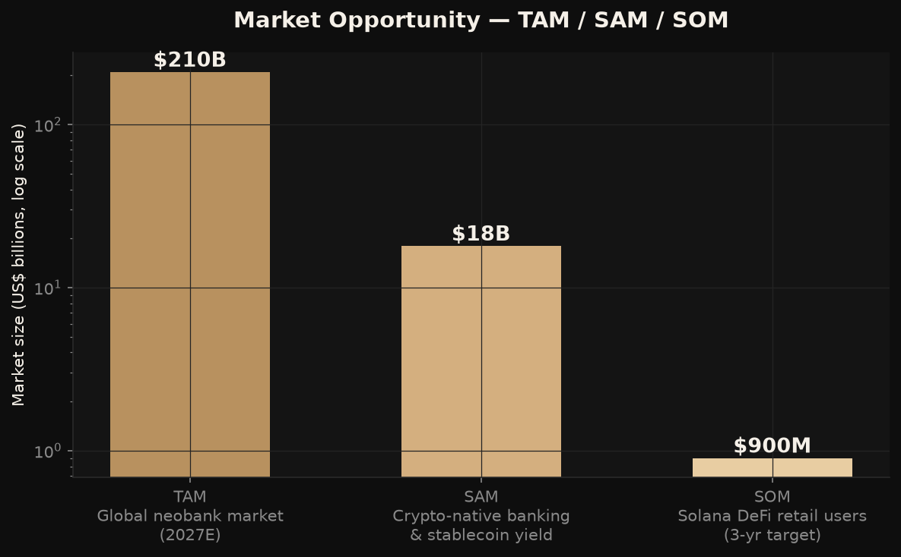
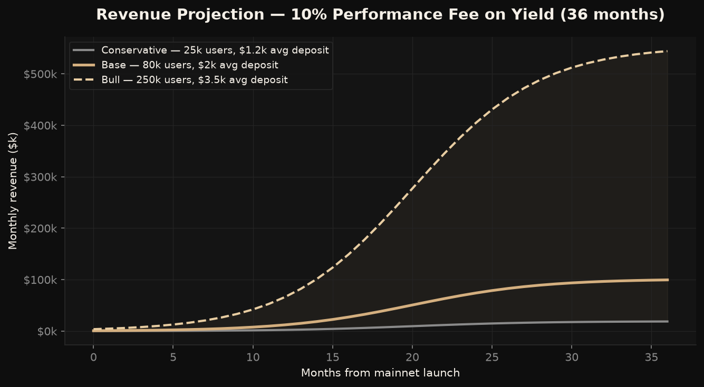
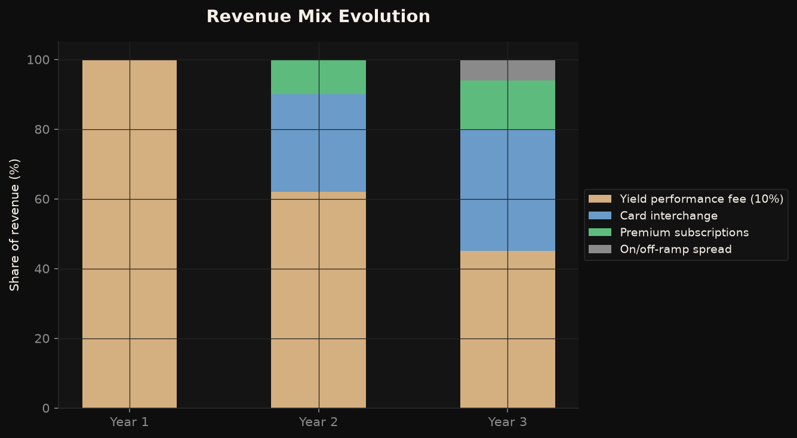
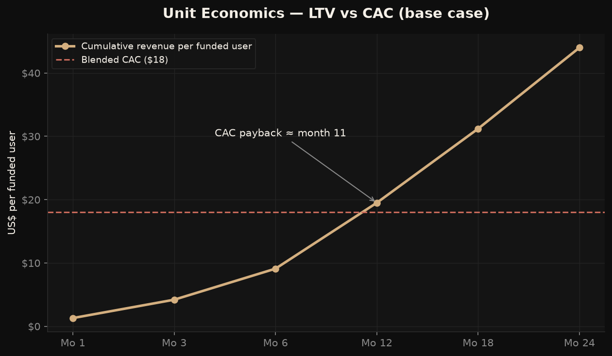
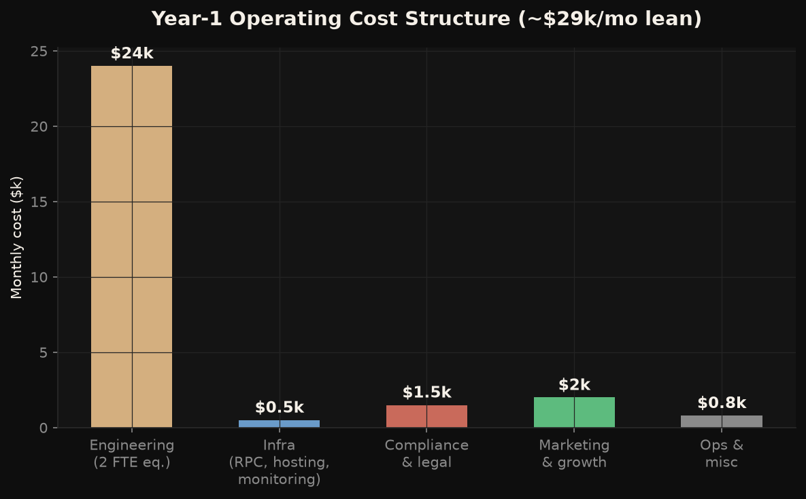
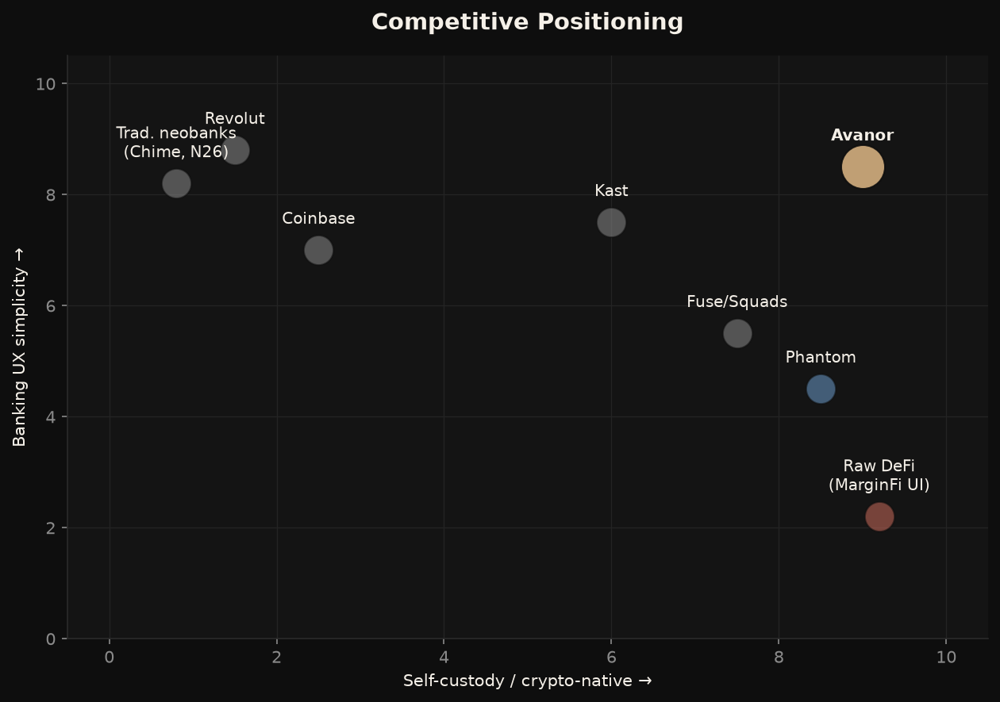
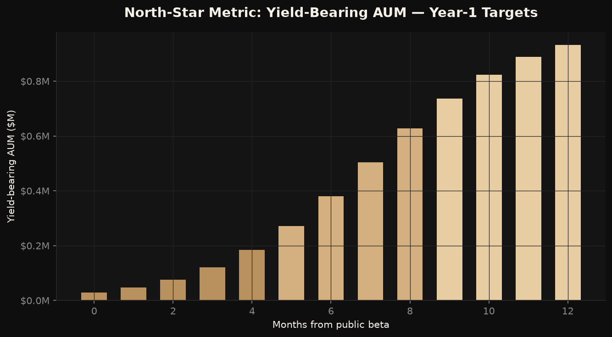

# Avanor — Business Plan

*The non-custodial neobank on Solana. Prepared June 2026.*

---

## 1. Executive Summary

Avanor is a non-custodial neobank built on Solana. It gives everyday users a banking-grade experience — a clean account, instant payments, a card on the roadmap — while their idle balances automatically earn DeFi yield through MarginFi. Users hold their own keys via Privy embedded wallets; Avanor never takes custody.

**The one-line pitch:** *a high-yield checking account where the bank can't touch your money.*

- **Status:** open beta live on Solana Devnet at [solana-neobank-beta.vercel.app](https://solana-neobank-beta.vercel.app)
- **Revenue model:** 10% performance fee on yield earned (never on principal), expanding into card interchange and premium subscriptions
- **Ask/keystone goal:** reach $1M in yield-bearing AUM within 12 months of public mainnet beta

## 2. The Problem

1. **Banks pay nothing.** The average US checking account yields ~0.07%; even "high-yield" savings tops out near 4% with withdrawal limits and custodial risk.
2. **DeFi pays well but is unusable.** Earning 5–8% on USDC via lending protocols requires wallets, seed phrases, RPC endpoints, and protocol-specific UI — a non-starter for normal people.
3. **Crypto "earn" products keep custody.** CeFi yield products (the BlockFi/Celsius generation) imploded because users surrendered their keys. Trust in custodial yield is permanently damaged.

The gap: nobody has packaged **self-custody + automatic yield + banking UX** into one product on a chain fast and cheap enough to feel like a bank.

## 3. The Solution

Avanor abstracts all of it away:

- **Sign in with Google/GitHub** → a self-custodied Solana wallet is created invisibly (Privy embedded wallets, keys never touch our servers)
- **Deposit USDC** → one tap routes it into MarginFi lending, earning live APY (~7.6% gross at current rates)
- **Watch it grow** → real-time balance, yield accrual, and transaction history in a private-banking-grade interface
- **Spend it** *(roadmap)* — Visa card that auto-unwinds yield positions at the point of sale

Solana is the enabling technology: ~400ms settlement and sub-cent fees make "your checking account is a DeFi position" economically viable per transaction, which is impossible on Ethereum L1.

## 4. Market Opportunity

- **TAM — $210B:** projected global neobank market revenue by 2027.
- **SAM — $18B:** crypto-native banking and the stablecoin yield economy (stablecoin supply >$230B, with yield-bearing share growing fastest).
- **SOM — $900M:** revenue pool reachable through Solana's retail DeFi user base (several million MAW) over a 3-year horizon.

The structural tailwind: stablecoins are becoming the dominant settlement rail for emerging-market savings and remittances, and regulatory clarity (MiCA, US stablecoin legislation) is pulling them mainstream. Every new stablecoin holder is a potential Avanor depositor.

## 5. Product & Technology

| Layer | Choice | Why |
|---|---|---|
| Chain | Solana (devnet → mainnet) | 400ms settlement, sub-cent fees |
| Auth + wallets | Privy embedded wallets | Web2 login UX, user-held keys, token verification server-side |
| Yield | MarginFi USDC lending | Battle-tested, permissionless, transparent on-chain |
| Frontend | Next.js 14 on Vercel | Fast iteration, edge delivery |
| Backend | Fastify + Prisma + Postgres on Railway | Typed, lean, cheap |
| Security | Server-side Privy token verification, helmet headers, rate limiting, faucet throttling, Sentry monitoring | Defense in depth from day one |

**Architectural principle:** the backend is an *indexer and transaction-builder*, never a custodian. Transactions are prepared server-side, signed client-side by the user's embedded wallet, and verified on-chain before being recorded.

## 6. Business Model

**Primary engine — performance fee:** Avanor takes 10% of yield generated, never touching principal. At 7.6% gross APY this is ~0.76% of AUM per year of pure software margin.

| Scenario (month 36) | Funded users | Avg deposit | AUM | Monthly revenue |
|---|---|---|---|---|
| Conservative | 25,000 | $1,200 | $30M | ~$19k |
| Base | 80,000 | $2,000 | $160M | ~$101k |
| Bull | 250,000 | $3,500 | $875M | ~$554k |

**Revenue stack over time:**
1. **Year 1:** performance fee only — keeps the product honest and aligned with users.
2. **Year 2:** card interchange (~1% of card spend) after Visa program launch; premium tier ($8–12/mo: higher yield routing, multi-account, priority support).
3. **Year 3:** on/off-ramp spread share via fiat partners.

## 7. Unit Economics

- **Blended CAC target: $18** per funded user (see Marketing Plan for channel detail)
- **Revenue per funded user:** ~$15–20/year at $2k average deposit, growing with deposit size and card attach
- **CAC payback: ~11 months**; LTV:CAC reaches ~2.4x at month 24 on yield alone — card interchange and premium push it past 4x
- Critically, **marginal cost per user is near zero** (RPC + DB rows), so contribution margin exceeds 90% at scale

## 8. Cost Structure

Lean year-1 burn of **~$29k/month** (~$350k/year):

- Engineering: 2 FTE-equivalents (founder + contractor or AI-augmented solo dev) — $24k/mo
- Infrastructure: Helius paid RPC, Vercel Pro, Railway, Sentry — under $500/mo at beta scale
- Compliance & legal: entity setup, ToS/Privacy counsel review, jurisdiction analysis — $1.5k/mo amortized
- Marketing & growth: $2k/mo in year 1, scaling with traction (see Marketing Plan)

Break-even at base case occurs around month 22–26 post-mainnet — or far earlier with a small pre-seed to fund the gap.

## 9. Competition

| Competitor class | Examples | Their weakness |
|---|---|---|
| Traditional neobanks | Chime, Revolut, N26 | Custodial, near-zero yield, no crypto rails |
| CEX "earn" | Coinbase, Kraken | Custodial; users remember Celsius |
| Crypto cards | Kast, Gnosis Pay | Spend-focused, weak yield story, mostly EVM |
| Solana wallets | Phantom, Solflare | Power-user tools, not banking UX, no fiat framing |
| Raw DeFi UIs | MarginFi's own app | Crypto-native only; intimidating to normies |

**Avanor's wedge:** the only product pairing *true self-custody* with *banking-grade simplicity* on the fastest retail chain. Defensibility comes from brand trust ("the safe way to earn"), UX polish, and eventually the card/fiat integrations that are operationally hard to replicate.

## 10. Security & Compliance Posture

Security is the product. Current implementation (shipped):

- Server-side **Privy access-token verification** — API identity is cryptographic, never client-asserted
- Helmet security headers + strict CORS on the API; HSTS, frame-deny, nosniff on the web app
- Per-IP rate limiting on all API routes; per-IP and per-address faucet throttling
- AES-256-GCM encryption of any sensitive material at rest; secrets in env vaults, never in code
- Sentry error monitoring on both tiers; structured logging

Compliance roadmap: non-custodial architecture keeps Avanor outside most money-transmitter definitions in the near term, but card issuance and fiat ramps (Phase 3) will be done **through licensed partners** (issuer-as-a-service + regulated on-ramp providers), with geo-fencing and sanctions screening at signup before mainnet.

## 11. Risks & Mitigations

| Risk | Mitigation |
|---|---|
| MarginFi exploit or insolvency | Diversify to multi-protocol routing (Kamino, Solend) in Phase 2; cap exposure per protocol; transparent risk disclosures |
| Yield compression (APY falls) | Performance-fee model scales with yield, not fixed promises; add interchange revenue leg |
| Regulatory shift on DeFi front-ends | Non-custodial design, entity in favorable jurisdiction, geo-fencing tooling ready |
| Privy dependency | Export paths for keys; abstraction layer allows swapping wallet infra |
| Solana outage | Position as multi-rail long-term; communicate transparently — funds remain safe on-chain during halts |

## 12. Roadmap & Milestones

1. **Now → Month 1.5:** devnet hardening complete (auth, monitoring, legal, SEO — done), security review, mainnet config
2. **Month 1.5–3:** private mainnet alpha, 100 invited users, real-USDC caps ($500/user)
3. **Month 3–5:** public mainnet beta + referral program; target 5,000 registered / 2,000 funded
4. **Month 5–7.5:** card partner integration + fiat on-ramp
5. **Month 7.5+:** premium tier, mobile app, multi-protocol yield routing

**North-star metric: yield-bearing AUM.** Target $1M within 12 months of public beta; every other metric (signups, retention, deposits) feeds it.

