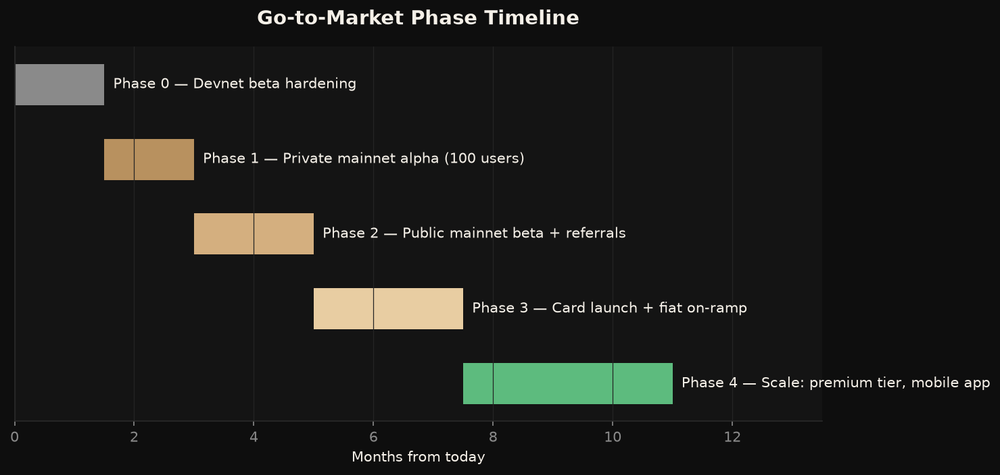
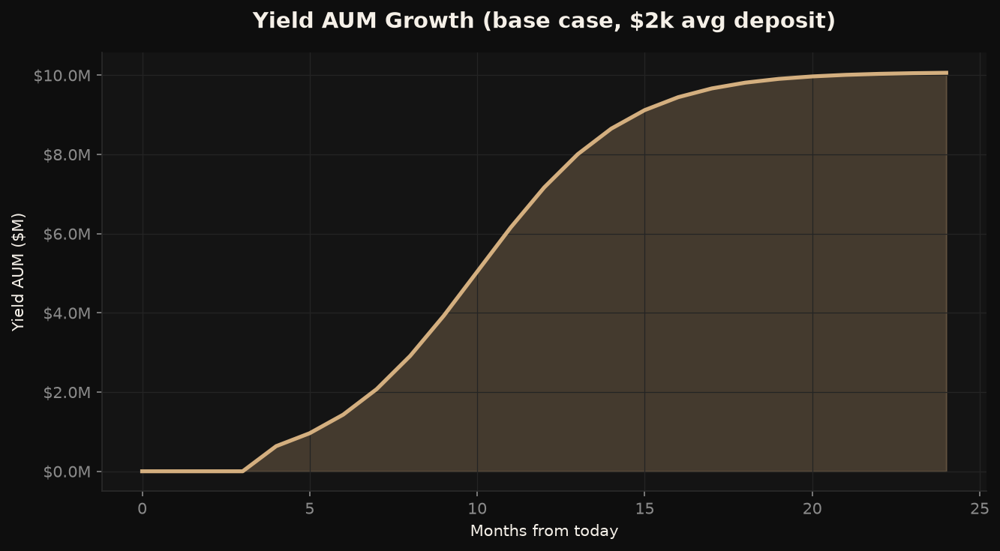

# Avanor — Go-to-Market Plan

*Prepared June 2026.*

---

## 1. GTM Thesis

Avanor wins by **sequencing trust**. A banking product cannot blitz-launch; every phase exists to manufacture the credibility the next phase spends. The motion: harden → prove with a small real-money cohort → open publicly with referral mechanics → add the card to 10x wallet share → scale.

## 2. Phase 0 — Devnet Beta Hardening (now → month 1.5)

**Goal:** a production-grade foundation. *Largely complete.*

- [x] Server-side Privy token verification (identity is cryptographic, not client-asserted)
- [x] Security headers, CORS lockdown, rate limiting, faucet hardening
- [x] Error monitoring (Sentry), analytics (Vercel), legal pages, SEO/OG
- [x] Live deployment: [solana-neobank-beta.vercel.app](https://solana-neobank-beta.vercel.app)
- [ ] Helius paid tier (unblocks MarginFi yield flows — owner action)
- [ ] Privy production app + `PRIVY_APP_ID`/`PRIVY_APP_SECRET` on Railway (owner action)
- [ ] External security review / audit of tx-building paths
- [ ] Mainnet configuration behind a feature flag

**Exit criteria:** zero Sev-1 issues for 2 consecutive weeks of devnet beta use; audit findings resolved.

## 3. Phase 1 — Private Mainnet Alpha (months 1.5–3)

**Goal:** first real dollars, zero incidents.

- 100 invited users (Solana-native friendlies + waitlist top referrers)
- Deposit cap $500/user → max protocol exposure $50k
- Concierge onboarding (DM support); weekly feedback calls
- Instrument everything: funnel events, yield accrual accuracy, withdrawal latency

**Exit criteria:** 100% withdrawal success rate, yield accounting reconciles to the cent against on-chain state, NPS > 40.

## 4. Phase 2 — Public Mainnet Beta (months 3–5)

**Goal:** 5,000 registered / 2,000 funded / $250k AUM in 90 days.

**Launch week playbook:**
1. Security deep-dive post published (the trust artifact)
2. Product Hunt launch + founder X thread + Solana ecosystem newsletter placements
3. X Space with 2–3 Solana ecosystem voices
4. Referral program live from day one (20% fee-share, 12 months)
5. Caps raised progressively: $2k → $10k per user as AUM and monitoring mature

**Watch metrics:** signup→funded conversion (target 40%), D7 retention, support ticket volume per 100 users.

## 5. Phase 3 — Card + Fiat On-Ramp (months 5–7.5)

**Goal:** move from "where my yield lives" to "where my money lives."

- Visa debit card via issuer-as-a-service partner (Rain, Bridge/Stripe card stack — partner diligence starts in Phase 2)
- Fiat on-ramp embedded (Coinflow/MoonPay/Bridge) — kills the funding-friction leak in the funnel
- Card spend auto-unwinds yield position at point of sale: the signature demo moment
- Compliance: geo-fencing, sanctions screening at signup, partner KYC flows

**Exit criteria:** 25% card attach rate among funded users; interchange revenue live.

## 6. Phase 4 — Scale (month 7.5+)

- Premium tier ($8–12/mo): multi-protocol yield routing, sub-accounts, priority support
- Mobile app (React Native reusing the API layer)
- Multi-protocol yield (Kamino, Solend) with risk-weighted allocation
- EM corridor experiments (LatAm first: Argentina/Venezuela stablecoin savings demand)

## 7. Targets Summary

| Milestone | Target date | Metric |
|---|---|---|
| Mainnet alpha | Month 1.5 | 100 users, $50k AUM cap, zero incidents |
| Public beta | Month 3 | launch week: 1,500 signups |
| Beta + 90 days | Month 6 | 5,000 registered, $250k AUM |
| Card live | Month 7.5 | 25% attach |
| North star | Month 15 | **$1M yield-bearing AUM** |

## 8. Risks & Contingencies

| Scenario | Trigger | Response |
|---|---|---|
| Protocol incident (MarginFi) | Any exploit/depeg | Pause deposits via flag, transparent comms within 1h, withdrawal-only mode |
| Slow funded conversion | <25% at beta+30d | Shift budget to on-ramp acceleration; first-deposit bonus from fee treasury |
| Card partner delays | >6 weeks slip | Decouple Phase 3: ship on-ramp alone (bigger funnel impact than card) |
| Competitor copy-launch | Funded clone appears | Out-execute on trust: publish audits, transparency reports; ship EM corridors |
| Regulatory pressure on front-ends | Guidance change | Geo-fence affected jurisdictions; entity domicile review (pre-arranged counsel) |

## 9. Owner Action Items (pre-mainnet, in order)

1. Create Privy production app; set `PRIVY_APP_ID` + `PRIVY_APP_SECRET` on Railway and `NEXT_PUBLIC_PRIVY_APP_ID` on Vercel
2. Upgrade Helius to paid tier (unblocks yield deposit/withdraw batch RPC)
3. Set `SENTRY_DSN` / `NEXT_PUBLIC_SENTRY_DSN` (free Sentry tier is fine)
4. Engage a security reviewer for the transaction-building paths
5. Entity formation + counsel review of ToS/Privacy (drafts shipped in `/legal`)
6. Begin card-issuer and on-ramp partner conversations (long lead times — start early)
