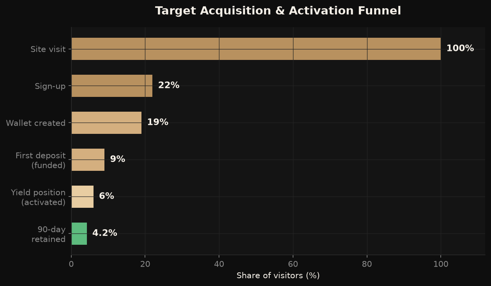
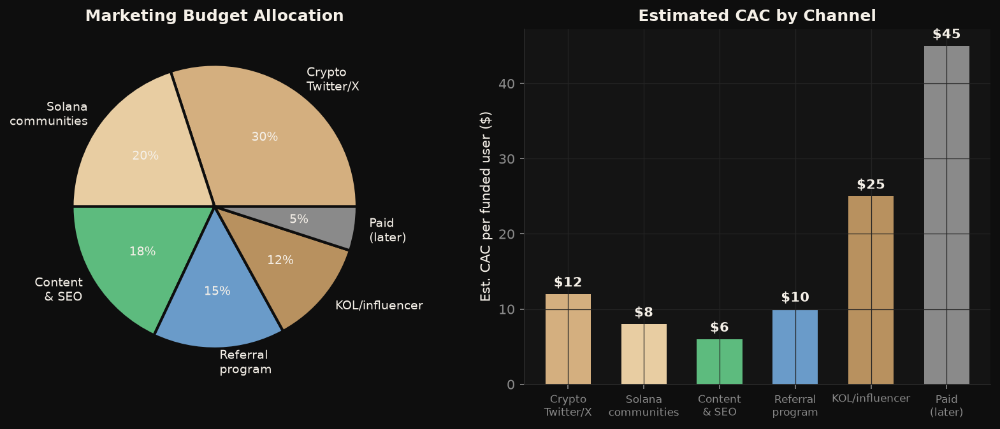
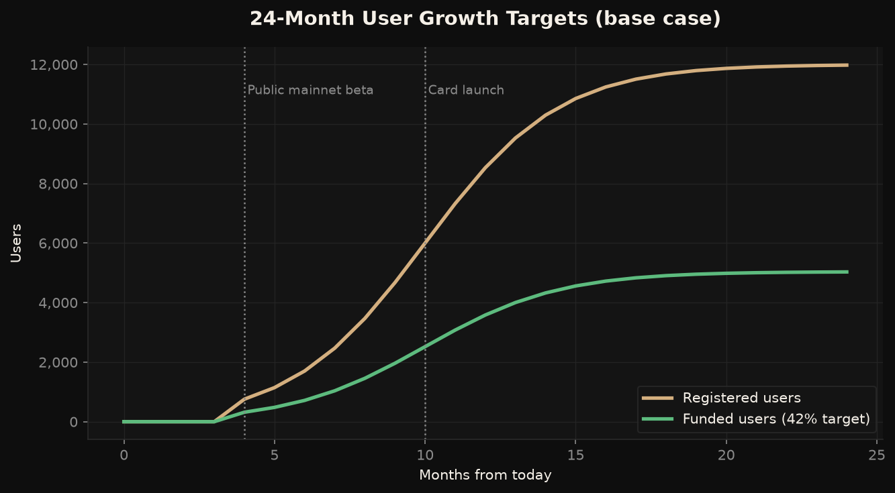

# Avanor — Marketing Plan

*Prepared June 2026.*

---

## 1. Positioning

**Category:** the non-custodial neobank.
**Promise:** *"Your money, always earning — and only you hold the keys."*

Avanor is not marketed as a DeFi protocol, a wallet, or an exchange. It is marketed as **a better bank account**, with crypto as the invisible engine. This framing decision drives everything: vocabulary ("account", "deposit", "earn" — never "pool", "stake", "LP"), visual identity (private-banking gold-on-black, not neon degen), and channel selection.

**Brand pillars**

1. **Sovereignty** — we can't touch your money. Not a promise; an architecture.
2. **Effortless yield** — earning is the default state of your balance, not a product you opt into.
3. **Speed** — Solana settlement in under half a second; banking that feels like messaging.
4. **Candor** — fees in one sentence (10% of yield, never principal), risks stated plainly.

## 2. Audiences & Personas

| Persona | Who | Pain | Hook |
|---|---|---|---|
| **The Yield Refugee** (primary) | 25–40, holds USDC/USDT on an exchange, burned by or wary of CeFi | Wants yield without surrendering custody | "Earn like DeFi. Sleep like cold storage." |
| **The Solana Native** | Active on-chain, uses Phantom + Jupiter daily | Yield is scattered, UX is spreadsheet-tier | "Your idle USDC is leaking APY." |
| **The EM Saver** (Phase 3+) | LatAm/SEA, saves in stablecoins against inflation | Local banks unsafe/inflationary; DeFi too complex | "A dollar account they can't freeze." |

## 3. Funnel Model & Targets

Target steady-state conversion: **22%** visit→signup (one-tap social login is the weapon — no seed phrase wall), **9%** visit→funded, **4.2%** retained at 90 days. The funnel's critical leak is signup→funded; the in-app devnet faucet (today) and instant on-ramp (Phase 3) attack exactly that step.

## 4. Channels & Budget

Year-1 budget is deliberately small (~$2k/mo) and weighted to **organic, high-trust channels**:

1. **Crypto Twitter/X (30%)** — founder-led building-in-public thread cadence (2–3/week): security architecture posts, AUM milestones, yield screenshots. Authenticity > ads in this market.
2. **Solana communities (20%)** — Superteam, Solana Tech Discord, hackathon circuit, ecosystem newsletters (Solana Floor, Helius blog guest posts). Apply for Solana Foundation grants — money *and* distribution.
3. **Content & SEO (18%)** — own the comparison queries before competitors exist: "best USDC yield", "non-custodial savings account", "MarginFi vs Kamino for savings", "is CeFi earn safe". Estimated CAC $6 — cheapest channel, compounds for years.
4. **Referral program (15%)** — double-sided: referrer earns 20% of referee's performance fees for 12 months; referee gets fee-free first 90 days. Cost scales only with success.
5. **KOL/influencer (12%)** — 3–5 mid-tier Solana voices (10–100k followers) on performance deals, not flat fees. No mega-influencers; wrong trust profile for a banking product.
6. **Paid (5%, later)** — held in reserve until LTV is proven; crypto paid acquisition is expensive ($45+ CAC) and channel-restricted.

**Blended CAC target: $18 per funded user.**

## 5. Launch Narrative Arc

- **Tease (pre-mainnet):** "Banks pay 0.07%. Your USDC could earn 100x that — without giving up your keys." Waitlist with referral-gated position jumping.
- **Launch:** "The first non-custodial neobank is live on Solana." Product Hunt + X spaces with Solana ecosystem voices + a security-architecture deep-dive post (the trust artifact).
- **Sustain:** weekly transparency posts — real AUM, real APY paid, uptime, fee revenue. The dashboard *is* the marketing. A neobank's best ad is other people's yield.

## 6. Content Engine

| Format | Cadence | Goal |
|---|---|---|
| X threads (founder) | 2–3/week | Trust, reach, building-in-public |
| SEO articles | 2/month | Own high-intent queries |
| Yield/transparency report | monthly | Retention + shareable proof |
| Security deep-dives | quarterly | Differentiation artifact |
| Short demo videos | at each feature launch | Conversion (22% target needs show-don't-tell) |

## 7. KPIs

| Metric | 90 days post-beta | 12 months |
|---|---|---|
| Registered users | 5,000 | 12,000 |
| Funded users | 2,000 (40%) | 5,000 (42%) |
| Yield-bearing AUM | $250k | $1M+ |
| Blended CAC | <$25 | <$18 |
| 90-day retention (funded) | >45% | >55% |
| Referral share of signups | 15% | 30% |

